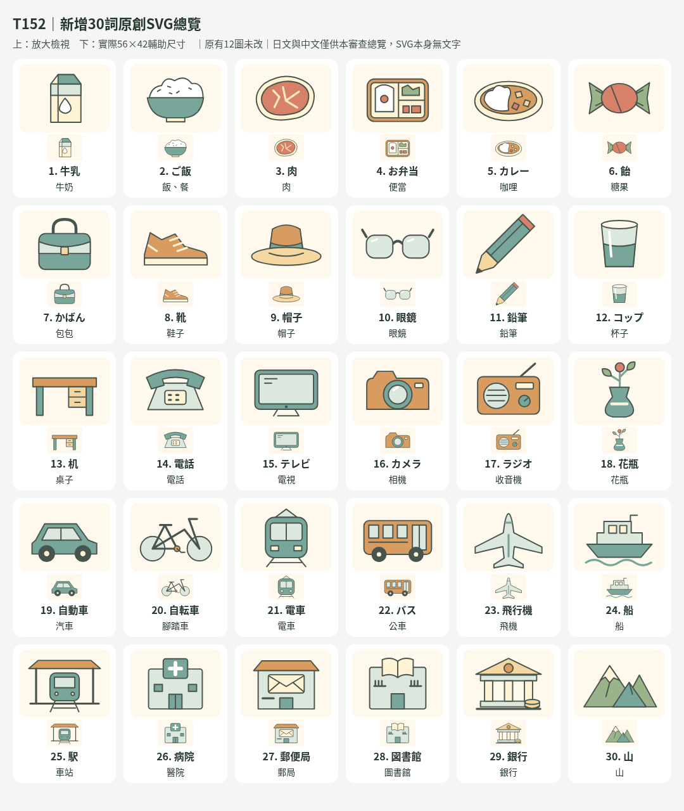
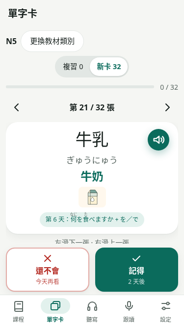
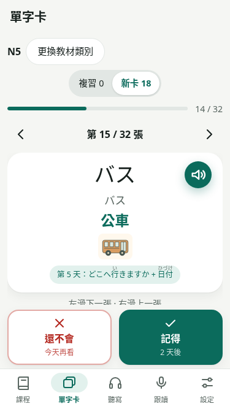
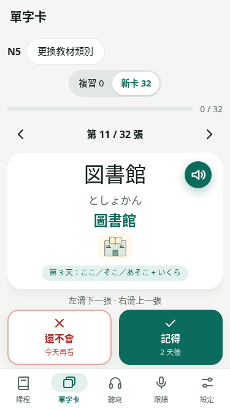
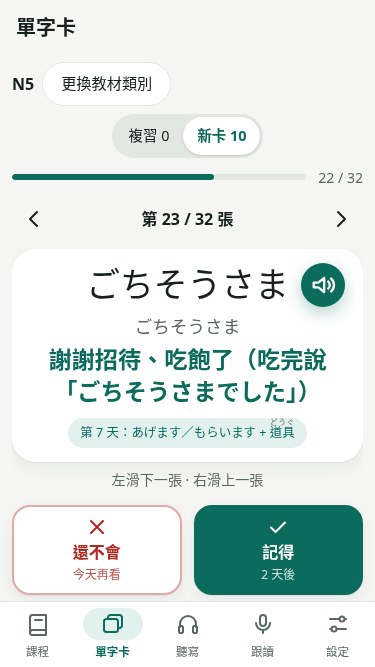
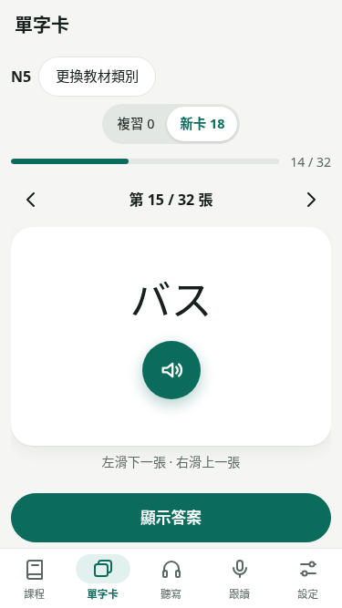

# T152 單字卡新增30詞配圖

基底main `0b7832bb28aa9f5170f36dcf7466198aca7e7f2e`，PR #157已發布。T151版面、空alt及精確映射契約不變；不新增教材或修改教材、音檔、進度與同步3。本批只到可審查PR，不合併部署。

## 編繪前選詞與語義核對

從curriculum/lessons.mjs的既有Card逐值讀取。食物6、日用品12、交通6、場所／自然景物6；29個N5映射及1個通用聽解映射。只新增以下30個明確ID，不按詞面推廣。舊12圖與映射保持。

| 類別 | 日文 | 讀音 | 原翻譯 | 資料ID | 資產 | 選詞理由與語義界線 |
|---|---|---|---|---|---|---|
| 食物 | 牛乳 | ぎゅうにゅう | 牛奶 | stage0-day6:牛乳 | milk.svg | 摺口紙盒與白色液滴標記，呈現牛奶紙盒的一例，不標品牌 |
| 食物 | ご飯 | ごはん | 飯、餐 | stage0-day6:ご飯 | rice.svg | 飯碗與白飯對應「飯」義；不以此圖定義所有「餐」的用法 |
| 食物 | 肉 | にく | 肉 | stage0-day6:肉 | meat.svg | 肉排與脂肪邊，呈現一般肉類一例，不猜測特定肉種 |
| 食物 | お弁当 | おべんとう | 便當 | stage0-day23:お弁当 | bento.svg | 有分隔的便當盒，與單一飯碗、咖哩盤區別 |
| 食物 | カレー | カレー | 咖哩 | stage0-day23:カレー | curry.svg | 盤中咖哩醬與白飯形成兩區，不只將白飯換色 |
| 食物 | 飴 | あめ | 糖果 | stage0-day23:飴 | candy.svg | 扭結包裝糖果；只配「あめ／糖果」，不配雨 |
| 日用品 | かばん | かばん | 包包 | stage0-day2:かばん | bag.svg | 有提把與袋身的包，不標品牌 |
| 日用品 | 靴 | くつ | 鞋子 | stage0-day13:靴 | shoes.svg | 鞋底、鞋舌與鞋帶的包鞋，與帽子等穿戴物輪廓不同 |
| 日用品 | 帽子 | ぼうし | 帽子 | stage0-day13:帽子 | hat.svg | 帶帽冠及帽緣的帽子，呈現帽類一例 |
| 日用品 | 眼鏡 | めがね | 眼鏡 | stage0-day13:眼鏡 | glasses.svg | 兩鏡框、鼻橋及鏡腳，輪廓明確 |
| 日用品 | 鉛筆 | えんぴつ | 鉛筆 | stage0-day2:鉛筆 | pencil.svg | 露出木質與筆芯的削尖鉛筆，不套原子筆或鋼筆 |
| 日用品 | コップ | コップ | 杯子 | stage0-day7:コップ | glass.svg | 無把手的透明杯，與牛奶紙盒、花瓶不同 |
| 日用品 | 机 | つくえ | 桌子 | stage0-day2:机 | desk.svg | 桌面、桌腳及抽屜；不以椅子圖換色 |
| 日用品 | 電話 | でんわ | 電話 | stage0-day3:電話 | telephone.svg | 聽筒加按鍵座機對應電話物件；不推廣到通話行為詞 |
| 日用品 | テレビ | テレビ | 電視 | stage0-day2:テレビ | television.svg | 大螢幕及底座，與收音機音箱、相機鏡頭不同 |
| 日用品 | カメラ | カメラ | 相機 | stage0-day2:カメラ | camera.svg | 中央大型鏡頭、機身與快門鈕，沒有文字 |
| 日用品 | ラジオ | ラジオ | 收音機 | stage0-day2:ラジオ | radio.svg | 天線、喇叭與旋鈕；不混用電視螢幕 |
| 日用品 | 花瓶 | かびん | 花瓶 | stage0-day22:花瓶 | vase.svg | 窄頸寬腹瓶與簡單花枝，與飲用杯輪廓不同 |
| 交通 | 自動車 | じどうしゃ | 汽車 | stage0-day2:自動車 | car.svg | 四輪汽車側面，不自動配其他課的「車」 |
| 交通 | 自転車 | じてんしゃ | 腳踏車 | stage0-day5:自転車 | bicycle.svg | 兩個大輪、三角車架、踏板與把手 |
| 交通 | 電車 | でんしゃ | 電車 | stage0-day5:電車 | train.svg | 正面車頭、軌道與集電弓，與公車側面及車輪區分 |
| 交通 | バス | バス | 公車 | stage0-day5:バス | bus.svg | 長車身、連續窗戶與上下車門，不只替汽車換色 |
| 交通 | 飛行機 | ひこうき | 飛機 | stage0-day5:飛行機 | airplane.svg | 機翼、機尾與機身的俯視輪廓 |
| 交通 | 船 | ふね | 船 | general-listening-30:船 | boat.svg | 船身、駕駛艙與水波；只核實通用聽解30的船義 |
| 場所 | 駅 | えき | 車站 | stage0-day3:駅 | station.svg | 月台雨棚、軌道與停站車頭構成車站，不只畫行進電車 |
| 場所 | 病院 | びょういん | 醫院 | stage0-day3:病院 | hospital.svg | 綠色醫療十字及入口的醫院建築，不使用紅十字標誌 |
| 場所 | 郵便局 | ゆうびんきょく | 郵局 | stage0-day3:郵便局 | postoffice.svg | 有信封圖示與投遞口的郵局建築，不用文字郵政標記 |
| 場所 | 図書館 | としょかん | 圖書館 | stage0-day3:図書館 | library.svg | 開書圖示與書架輪廓的圖書館建築，與單本書區分 |
| 場所 | 銀行 | ぎんこう | 銀行 | stage0-day3:銀行 | bank.svg | 柱廊建築及硬幣堆疊表示銀行一例，非品牌標誌 |
| 場所 | 山 | やま | 山 | stage0-day12:山 | mountain.svg | 有明確山峰與坡線的山，不把天氣或登山行為配圖 |

## 容量與共用範圍

開始前precache21,347,454／21,500,000 bytes，491 URL、餘152546。預估30張SVG每張約400～900 bytes，加映射與授權說明約25～35 KB；必須以正式build實測，不放寬上限、改統計範圍或移除必要離線資產。本批30張資產／30個映射，總42張／42個映射；每張目前只對應一個已核實詞條，跨課重用機制沿用但沒有新增跨課映射。同詞其他課不自動配圖。

## 實際繪製與容量

新增30張SVG為本輪自行編繪的原創路徑，沿用T151的224×168、4:3、淺米背景、圓角3-unit輪廓與色盤；沒有文字、emoji、字型、外部引用、作品素材或腳本，CC0-1.0授權見public/images/vocab/README。逐張XML解析及實際瀏覽器檢視放大與56×42版本，修正開放線段預設黑填色，補強牛奶紙盒與銀行硬幣圖示後再檢視；沒有改原12圖。

新增15,940 bytes、總42圖22,267 bytes。正式build實測：main gzip65661／630000、CSS5068／5800、precache21,368,531／21,500,000 bytes，521去重URL、餘131469，對main增21,077 bytes。原預快取glob、bundle上限及離線下載語意保持；單元測試保留原12圖12000 bytes小批預算，另為新增30圖設24000 bytes預算，不以更動正式bundle門檻製造通過。

## 完成驗證與限制

330 tests／check、正式base build／perf:bundle通過。四組375寬牌組共136張線上／真正離線流程，涵蓋全部新增30詞的兩模式、揭示、1倍完整播放、評分／改評、滑動與進度；2個舊圖映射及無圖長翻譯／長單字一併回歸。42圖離線SHA一致，文字中心線、圖片比例、操作區及無障礙樹正常，線上圖片請求失敗與離線清快取缺圖可繼續學習。實際範圍及離線環境旗標問題見release-audit T152，不以手機模擬當真機或以無障礙樹當實體螢幕閱讀器試聽。

只到可審查PR；CI依精確head的最新結果補記PR，不合併部署、不新增下一批、不宣稱記憶效果。

## 30圖總覽與實際375寬卡片

總覽日中標籤在文件版面，SVG資產本身無文字；每格含放大圖與實際56×42小圖供reviewer核對。以下卡片由正式base建置的獨立合成進度直接截圖，沒有合成示意或改DOM。

