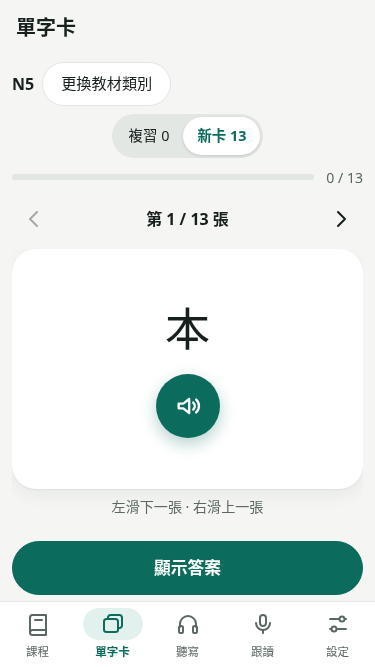

# T151 單字卡答案面配圖UX試版

範圍：基於main `4f723b9`，只替12個核實過的既有N5詞條配圖。不改教材文字／音檔／ID、FSRS、同步v3、四類練習、課程頁或對話；不製作漫畫／動畫，不增加看圖猜詞或設定彈窗。此試版用於評估呈現與操作，尚未驗證記憶效果。

## 呈現與退化

回想面保留日文及播放鍵，圖片元件只在`revealed`答案區掛載，與讀音／翻譯並排，下方保留原課名。224×168的SVG以88×66呈現；有配圖答案面將日文與播放鍵排成同列，圖片與讀音／翻譯並排，課名在下；手機卡片內容獨立垂直捲動，評分列保留在內容區外，不遮住答案或被圖片推離操作區。桌面沿用原操作區位置。按鈕、空白揭示、1／2評分、左右滑動不評分、回看已評卡直接顯示答案、回頭改評從原始狀態重算，均維持原語意。

`lib/vocab-illustrations.mjs`以卡片ID＋word／reading／zh完整吻合才對應圖片，未核實的同詞卡與不同義項不自動配圖。圖片資料獨立於教材／Card與同步資料，不重建ID。每張圖片可被明確列入的卡片共用，本批僅12個對應。時計圖是「鐘、錶」的一例，並非完整定義；かぎ只配「鑰匙」義，橋是はし／橋義。

沒有配圖仍走原文字流程；圖片載入失敗時移除圖片元件，不顯示阻塞訊息、不阻止播放或評分。換卡以穩定ID重建圖片元件，前張失敗狀態不傳到下一張。替代文字描述實際畫面，不在答案揭示前出現在可及性樹。圖片不可拖曳，不攔截原滑動手勢。無新增動畫或偏好項；沿用既有減少動態效果樣式。

## 12個核實詞條

| 卡片ID | 日文／讀音 | 原翻譯 | SVG |
| --- | --- | --- | --- |
| stage0-day6:パン | パン／パン | 麵包 | bread.svg |
| stage0-day14:地図 | 地図／ちず | 地圖 | map.svg |
| stage0-day2:傘 | 傘／かさ | 雨傘 | umbrella.svg |
| stage0-day6:卵 | 卵／たまご | 蛋 | egg.svg |
| stage0-day6:魚 | 魚／さかな | 魚 | fish.svg |
| stage0-day2:本 | 本／ほん | 書 | book.svg |
| stage0-day7:かぎ | かぎ／かぎ | 鑰匙 | key.svg |
| stage0-day10:いす | いす／いす | 椅子 | chair.svg |
| stage0-day2:時計 | 時計／とけい | 鐘、錶 | clock.svg |
| stage0-day3:学校 | 学校／がっこう | 學校 | school.svg |
| stage0-day14:橋 | 橋／はし | 橋 | bridge.svg |
| stage0-day13:公園 | 公園／こうえん | 公園 | park.svg |

## 來源、容量與離線

12張均為本批自行繪製的SVG原創向量，固定色盤／圓角線條／簡潔背景，沒有文字、字型、emoji、作品素材、外部引用或腳本；逐張檢視主體與義項，修正地圖路線填色與書本封面後再檢視。以CC0-1.0提供本批SVG，詳見`public/images/vocab/README.md`；不改其他資產授權。不是圖像生成工具產物，也沒有從搜尋結果下載圖片。

每張224×168、4:3；12張合計6327 bytes。沿用現行`**/*.{js,css,html,ico,png,jpg,svg}`預快取規則，首次成功安裝／更新service worker即下載並提供離線圖片，不另加圖片下載開關或外部服務。圖片缺漏仍可學習，瀏覽器清除快取後需重新連線取得；音檔仍須按既有方式明確下載，沒有改成播放即下載或改音檔快取名稱。

最新main正式base基準：main gzip65652、CSS gzip4817、precache21337719／21500000、479 URL，餘162281。試版：main gzip65662、CSS gzip5004、precache21347203／21500000、491 URL，餘152797；precache增9484 bytes，包含6327 bytes圖片及相關程式／樣式。原630000／5800／21500000上限、資產統計範圍與必要離線集合均未變，沒有runtime dependency或T122計時Gate。

驗證結果與限制按實際執行補入release-audit；本輪只建立可審查PR，等待使用者評估手機畫面，不合併部署或擴大配圖。

## 本機驗證與預覽

330 tests／check、正式base build／原bundle通過；兩模式各13詞線上／真正離線、缺圖退化、其他三類無圖長卡與保存回歸完成，實際範圍及前置修正見release-audit T151。真斷網重載後12張圖片逐SHA一致，沒有記憶成效實驗。三張PNG為隔離測試資料的375×667畫面，不納入runtime資產。

