# T154 動作／抽象詞單字卡SVG設計試作

預算T153已獨立合併；本PR只盤點、規劃及12詞試作，**不合併、不部署**。原文字置中、答案後56×42輔助圖、空alt與課程來源位置均不改。沒有新增教材、修改ID／排程／同步3／音檔或依賴。

正式站仍為42資產／42映射；本分支12新增圖／12精確映射，合計54／54，沒有新增跨課套用。所有12詞皆已存在且原先無圖；同字其他課先不配。全站基準、保守義項定義與分批容量見[覆蓋計畫](vocab-illustration-coverage-plan.md)。

## 構圖與詞義

| 日文／讀音 | 原翻譯 | 精確資料ID | SVG | 如何表達與界線 |
|---|---|---|---|---|
| 走る／はしる | 跑（禮貌形：走ります） | stage0-day18:走る | running.svg | 前傾跑步、跨步與速度線，以人體動作區別單純走路；不限定角色性別。 |
| 待つ／まつ | 等（て形：待って） | stage0-day14:待つ | waiting.svg | 人在原地看向來路，小鐘表示等候的時間；不是以時鐘代替完整動作。 |
| 渡す／わたす | 交給、遞（て形：渡して） | stage0-day14:渡す | handing.svg | 左方主動者伸手把盒子交向右方收件者，色彩及箭頭提示交付方向。 |
| 重い／おもい | 重的 | stage0-day8:重い | heavy.svg | 彎膝且吃力的人抱重物並出汗，重點是負重特徵，不是石塊本身。 |
| 冷たい／つめたい | 冰的、涼的（東西、水） | stage0-day12:冷たい | cold.svg | 手接觸有冰塊的冷水杯，表現物體冷的觸感，不用全身發抖代替天氣冷。 |
| 静か／しずか | 安靜的（な形容詞） | stage0-day8:静か | quiet.svg | 安靜姿態與弱化聲音符號，輔助安靜狀態；不修改原有な形容詞解說。 |
| 約束／やくそく | 約定 | general-listening-03:約束 | promise.svg | 握手與沒有文字的約定日曆，呈現雙方約定日後碰面的具體情境。 |
| 理由／りゆう | 理由 | general-listening-23:理由 | reason.svg | 灑水造成滑倒的同一微情境，用箭頭連結原因與結果；只是一個理由的例子。 |
| 安心／あんしん | 安心 | general-listening-15:安心 | relief.svg | 收到報平安訊息後放鬆、手放胸前與舒氣，表達主觀放心，非只畫安全盾牌。 |
| ゆっくり／ゆっくり | 慢慢地 | general-listening-02:ゆっくり | slowly.svg | 同一個人輕鬆小步移動、短距腳印與小鐘，表現慢慢走這個方式，不等同所有慢。 |
| 一緒に／いっしょに | 一起 | general-listening-17:一緒に | together.svg | 兩人共同抬同一個箱子，以共同行動表達一起，不將圖限定為搬家詞。 |
| もう一度／もういちど | 再一次 | stage0-day14:もう一度 | again.svg | 左邊已完成的同一按鈕動作，單一返回箭頭引向右邊再按一次；不是無限重複。 |

## 審查焦點與需確認的表現方式

- 圖是揭示答案後的記憶聯想，不是看圖猜詞或完整字典定義。所有文字／讀音／翻譯仍是學習主體，不用圖中文字直接寫答案。
- 渡す：左方主動交付者比右方接收者更突出，物件和方向箭頭形成交給對方；需確認不被誤讀為取走／拿回，不能未核實就套受け取る或くれる。
- 冷たい：冰水與接觸手，重點是物體觸感，區別天氣寒い；静か以安靜姿態與低聲符號輔助，不新增命令句。
- 約束：握手＋約定日曆，只是一種約定場景，不把所有約束解釋為商業契約。理由：以灑水→滑倒表現「發生此事的原因」，仍可能被單看為滑倒，需使用者／reviewer確認文字下方輔助圖是否足夠清楚；不宣稱單圖能涵蓋所有理由。
- 安心：報平安訊息與放鬆姿態，表達主觀放心，不拿客觀安全盾牌代替。ゆっくり：小步、放鬆姿態與腳印／小鐘表現動作方式，非只畫步行名詞。
- 一緒に：兩人共同抬同一箱子，顯示共同行動。もう一度：同型按鈕的完成／再按兩狀態及單一箭頭；需審查是否會誤讀成下一個。這兩項不未經確認就推廣其他時間或次序副詞。
- 上述語義有界線者是本輪要審查的設計，不把待確認的抽象表現方式算成全站配圖完成；不同詞沒有套同一泛用圖。

## 來源、容量與驗證

12張224×168原創幾何SVG，沿用淺米背景、綠／土黃／珊瑚色及圓角3-unit線條。沒有文字、emoji、字型、外部資源、作品人物或截圖；本專案自製路徑，依public/images/vocab/README的CC0-1.0公開。逐張XML／安全檢查及實際56×42渲染，因果姿態與慢步幅已按總覽改善。

最終12圖7962 bytes（平均663.5），總54圖30229 bytes。332 tests／check、正式base build與perf:bundle通過：precache21,379,193／26,869,829、533 URL，餘5,490,636；較正式42圖增10662 bytes，含7962圖與2700映射／建置引用，main gzip65661及CSS5068不變。四組375寬合成資料共60張線上／真正離線流程：12詞兩模式各兩網路狀態48次、舊地圖4次、N5無圖長翻譯與通用無圖長詞8次；54圖兩狀態逐SHA、缺圖退化、播放／評分／改評／滑動保存、空alt及未參與合成進度保持。真斷網以BrowserContext.setOffline(true)、實際reload及每次離線播放前未快取請求ERR_INTERNET_DISCONNECTED為據，零pageerror／水平溢位。5909張Card全值／ID、原42圖／映射、全部8573音檔SHA保持。最新精確head CI仍待PR實際結果。手機模擬不是實體真機或螢幕閱讀器驗收，不宣稱記憶效果。

## 總覽與實際卡片預覽

每格含放大與56×42實際渲染；日中標籤只在總覽文件，SVG資產本身無文字。手機畫面為正式base建置與隔離合成進度的實際瀏覽器截圖，不以示意圖代替。

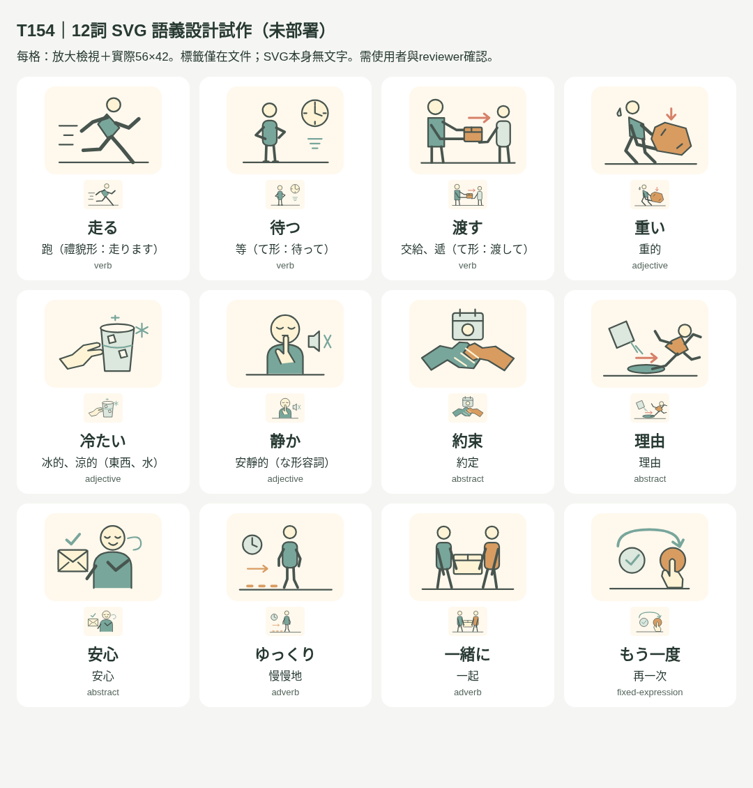

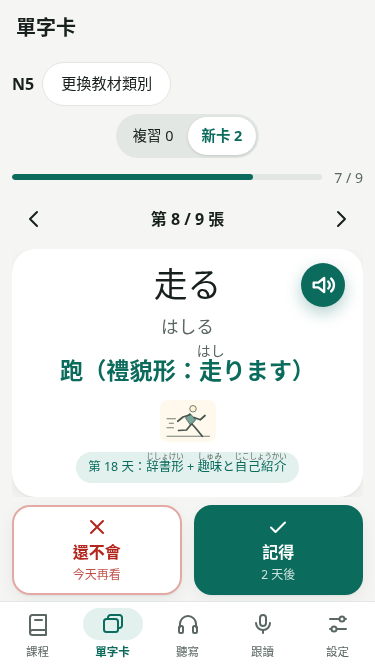

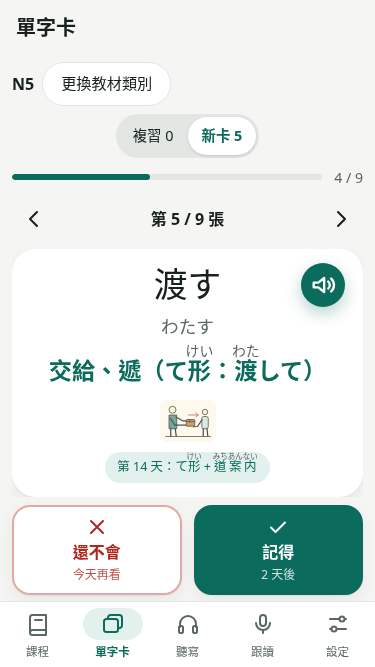

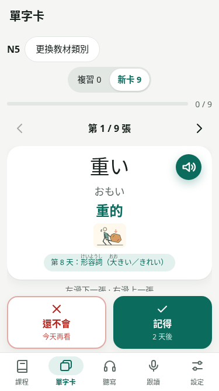

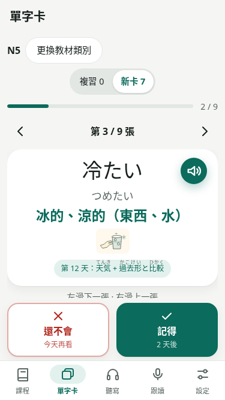

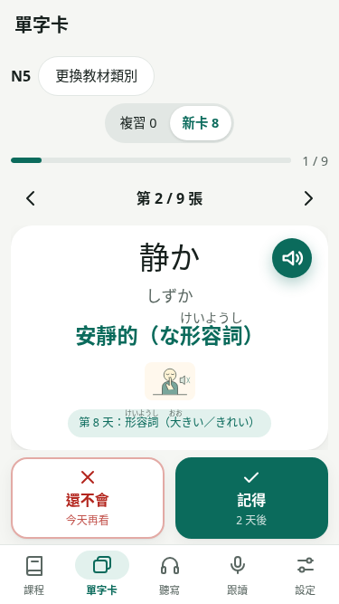

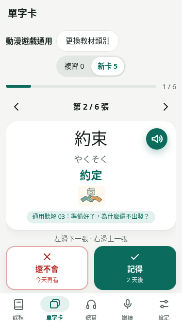

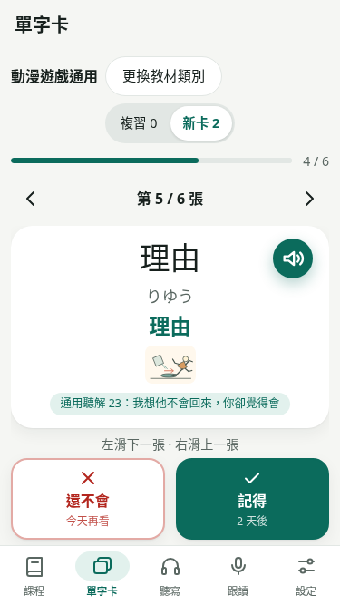

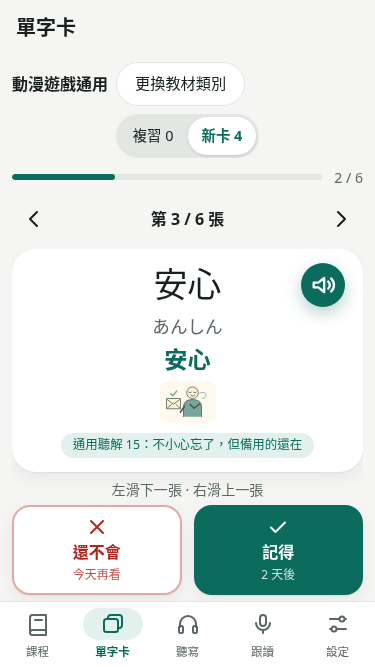

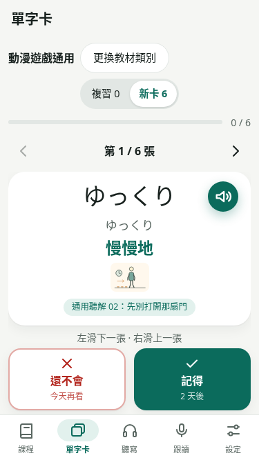

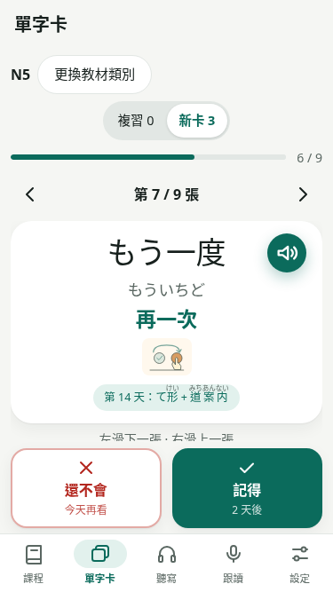

微情境是原創詞義示例，不宣稱來自該課對話或作品台詞，也不修改對話。冷たい最初曲線可能像蒸氣，校準為冰晶後重新完整check／build／預算與四組60流程，畫面均為校準後版本。

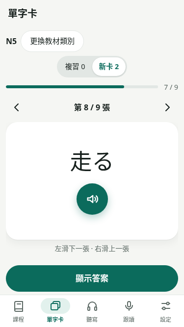
