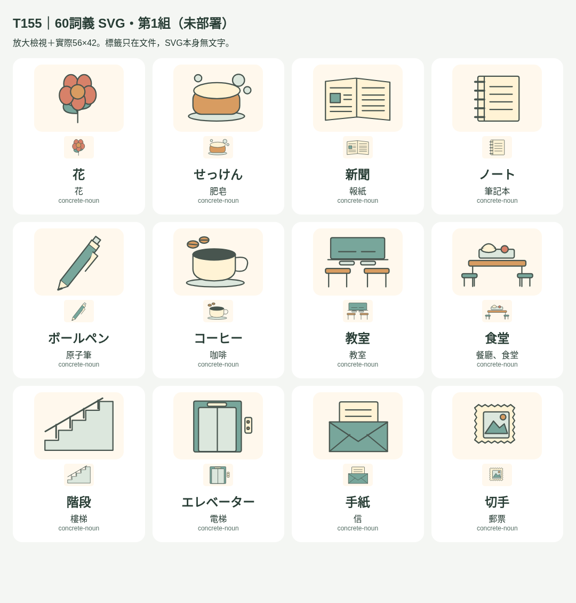
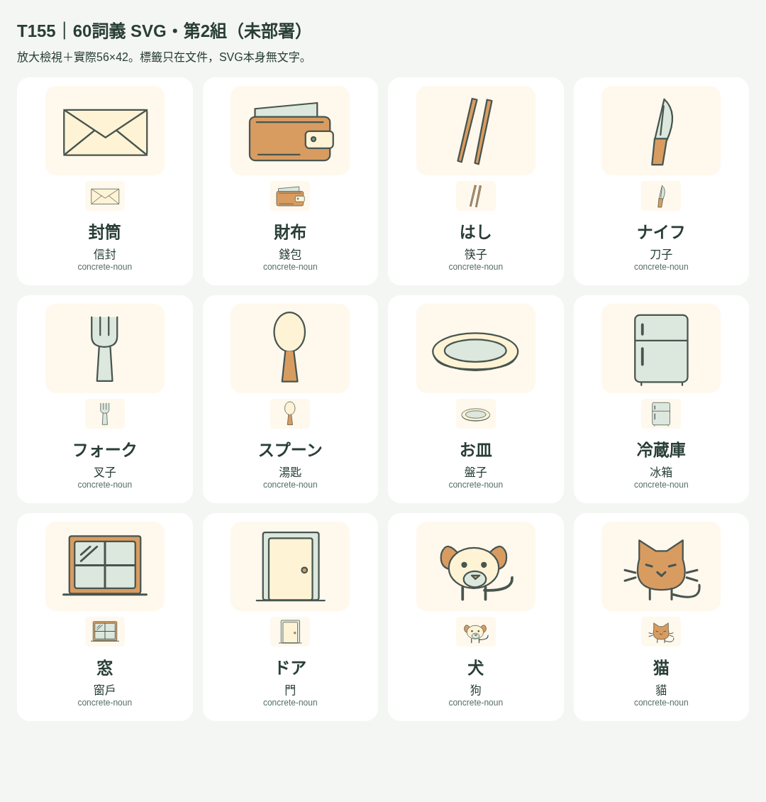
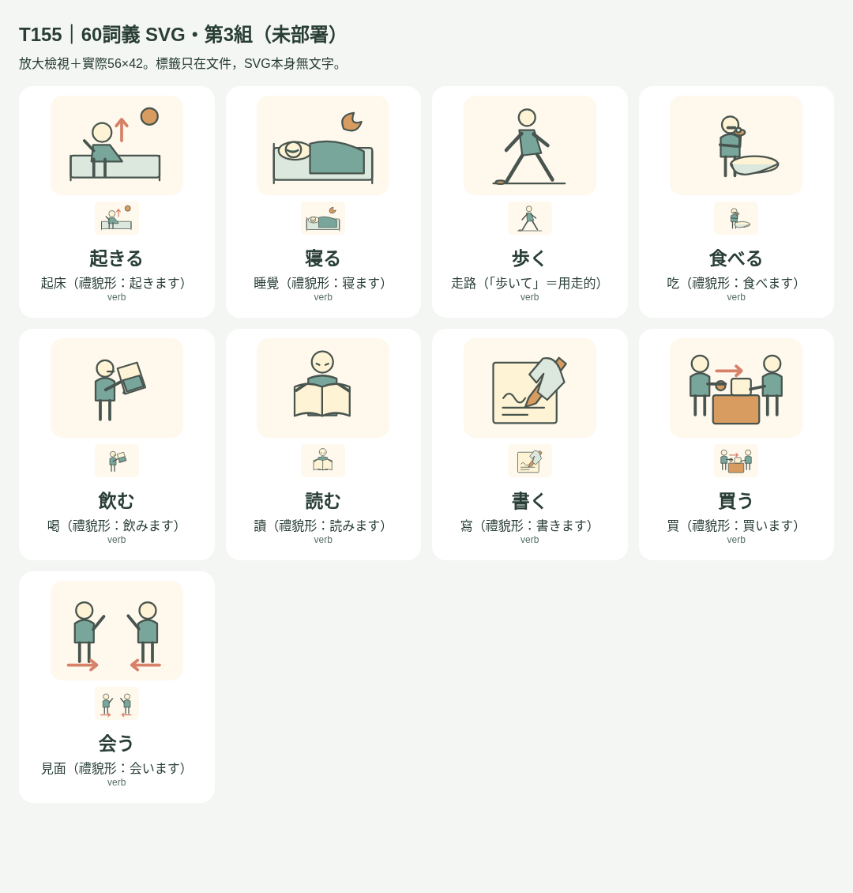
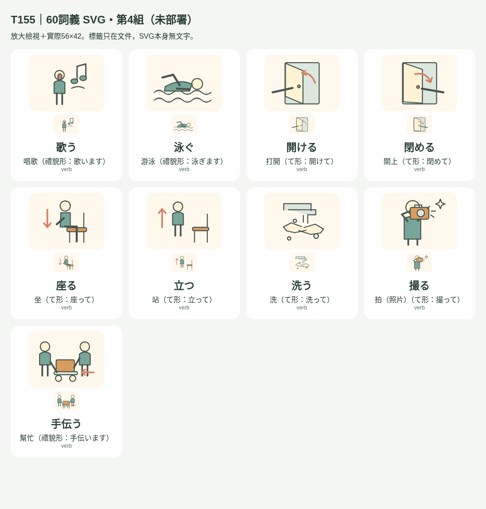
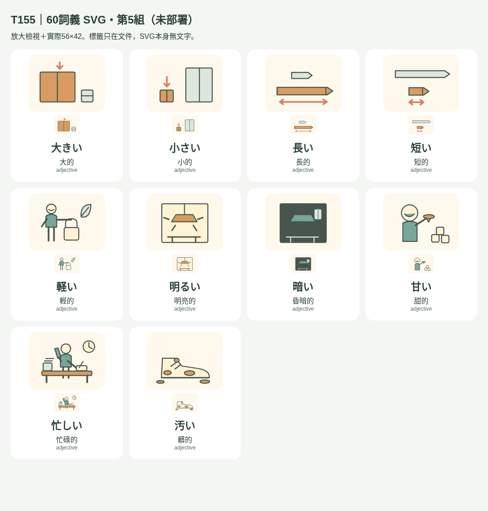
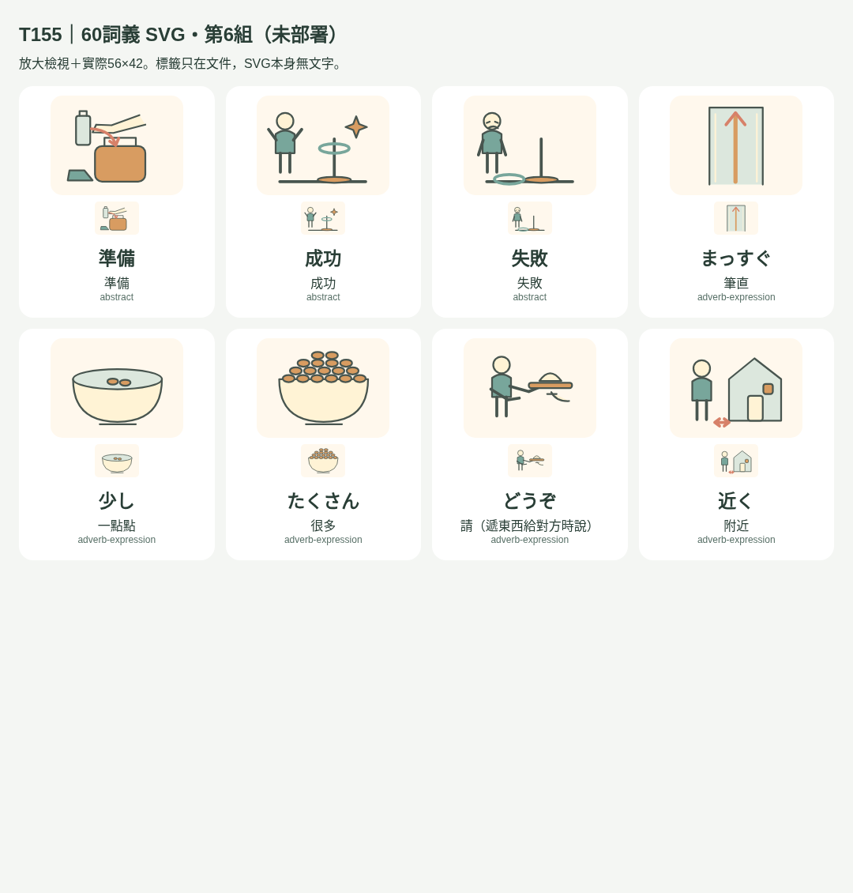

# T155：60個缺圖詞義與精確共用審查

本輪只擴充配圖，維持未合併／未部署PR。基準main `84c9449013babb00190b4d8dc8accfa56fdb9686`（PR #160已發布）：5909張卡、54 SVG／54映射、5855缺圖卡。詞義以本表指定的原詞條及解說為範圍，不以詞形數冒充人工詞義總數。

新資產60張，自行編繪的幾何SVG，CC0-1.0；無文字、emoji、外部資源、作品人物或搜尋圖片。沿用224×168、原色盤、3-unit圓角線條，實際顯示56×42。24具體名詞、18動詞、10形容詞、3抽象詞、5副詞／固定表達；每個圖示是該詞義的輔助例子，不代替完整定義或原教材情境。原54圖與原映射完整保留。

## 60個新詞義與資產

| # | 原詞面／讀音 | 原翻譯 | 精確ID | SVG | 構圖與義項界線 |
|---|---|---|---|---|---|
| 1 | 花／はな | 花 | `stage0-day7:花` | `flower.svg` | 單朵花與葉莖，不帶花瓶；對應花而非花瓶。 |
| 2 | せっけん／せっけん | 肥皂 | `stage0-day16:せっけん` | `soap.svg` | 圓角皂塊與泡泡，沒有清潔劑品牌或文字。 |
| 3 | 新聞／しんぶん | 報紙 | `stage0-day2:新聞` | `newspaper.svg` | 展開大幅報紙、折線與多欄排版；線段代表版面，不寫文字。 |
| 4 | ノート／ノート | 筆記本 | `stage0-day2:ノート` | `notebook.svg` | 有外露線圈與書寫橫線的筆記本，區別裝訂書與報紙。 |
| 5 | ボールペン／ボールペン | 原子筆 | `stage0-day2:ボールペン` | `ballpen.svg` | 帶按壓尾鈕、筆夾與圓珠筆尖，區別既有鉛筆。 |
| 6 | コーヒー／コーヒー | 咖啡 | `stage0-day2:コーヒー` | `coffee.svg` | 杯內深色咖啡搭配兩顆咖啡豆，杯子不是空的。 |
| 7 | 教室／きょうしつ | 教室 | `stage0-day3:教室` | `classroom.svg` | 黑板與成列課桌，表達教室內部而非校舍。 |
| 8 | 食堂／しょくどう | 餐廳、食堂 | `stage0-day3:食堂` | `canteen.svg` | 餐盤飯菜與多座餐桌，表達供餐／用餐空間的一例。 |
| 9 | 階段／かいだん | 樓梯 | `stage0-day3:階段` | `stairs.svg` | 連續階梯與扶手，無上下指令文字。 |
| 10 | エレベーター／エレベーター | 電梯 | `stage0-day3:エレベーター` | `elevator.svg` | 雙開金屬門、門框與旁側樓層按鈕，區別階梯與一般單扇門。 |
| 11 | 手紙／てがみ | 信 | `stage0-day7:手紙` | `letter.svg` | 信紙從信封露出，區別只畫空信封。 |
| 12 | 切手／きって | 郵票 | `stage0-day7:切手` | `stamp.svg` | 郵票齒孔與小幅山景，沒有面額或國名。 |
| 13 | 封筒／ふうとう | 信封 | `stage0-day7:封筒` | `envelope.svg` | 單一完整信封與封口，無露出的信紙，區別手紙。 |
| 14 | 財布／さいふ | 錢包 | `stage0-day7:財布` | `wallet.svg` | 可折錢包與扣帶，露出不印字的紙鈔，不畫成提包。 |
| 15 | はし／はし | 筷子 | `stage0-day7:はし` | `chopsticks.svg` | 一雙細長筷子，與同音橋分開。 |
| 16 | ナイフ／ナイフ | 刀子 | `stage0-day7:ナイフ` | `knife.svg` | 餐刀的刃與握柄，和叉子／湯匙輪廓不同。 |
| 17 | フォーク／フォーク | 叉子 | `stage0-day7:フォーク` | `fork.svg` | 明確叉齒與握柄。 |
| 18 | スプーン／スプーン | 湯匙 | `stage0-day7:スプーン` | `spoon.svg` | 橢圓匙面與細長握柄，無叉齒。 |
| 19 | お皿／おさら | 盤子 | `stage0-day7:お皿` | `plate.svg` | 有盤緣的淺盤，不畫成碗。 |
| 20 | 冷蔵庫／れいぞうこ | 冰箱 | `stage0-day10:冷蔵庫` | `fridge.svg` | 上下分層門與把手的冰箱，不用文字標示。 |
| 21 | 窓／まど | 窗戶 | `stage0-day10:窓` | `window.svg` | 牆面中的窗框、玻璃及窗台，沒有門把。 |
| 22 | ドア／ドア | 門 | `stage0-day10:ドア` | `door.svg` | 單扇門與門把，無動作箭頭，區別開關動詞。 |
| 23 | 犬／いぬ | 狗 | `stage0-day10:犬` | `dog.svg` | 垂耳、突出吻部與搖尾的狗，區別尖耳貓。 |
| 24 | 猫／ねこ | 貓 | `stage0-day10:猫` | `cat.svg` | 尖耳、鬍鬚與捲尾的貓。 |
| 25 | 起きる／おきる | 起床（禮貌形：起きます） | `stage0-day4:起きる` | `waking.svg` | 人物從床上坐起與上移箭頭，區別躺著睡覺。 |
| 26 | 寝る／ねる | 睡覺（禮貌形：寝ます） | `stage0-day4:寝る` | `sleeping.svg` | 閉眼人物平躺枕頭與被子下，月亮提示休息情境，不使用字母。 |
| 27 | 歩く／あるく | 走路（「歩いて」＝用走的） | `stage0-day5:歩く` | `walking.svg` | 直立人物正常跨步與落地腳印，沒有跑步速度線或慢速時鐘。 |
| 28 | 食べる／たべる | 吃（禮貌形：食べます） | `stage0-day6:食べる` | `eating.svg` | 湯匙將碗中的食物送到張開的嘴，區別喝水。 |
| 29 | 飲む／のむ | 喝（禮貌形：飲みます） | `stage0-day6:飲む` | `drinking.svg` | 杯子傾向嘴、手扶杯，沒有湯匙。 |
| 30 | 読む／よむ | 讀（禮貌形：読みます） | `stage0-day6:読む` | `reading.svg` | 張眼人物注視攤開書，焦點是閱讀動作，沒有安靜環境或噤聲圖示。 |
| 31 | 書く／かく | 寫（禮貌形：書きます） | `stage0-day6:書く` | `writing.svg` | 手持筆尖接觸紙張，筆跡是非文字線條，不把答案寫入圖片。 |
| 32 | 買う／かう | 買（禮貌形：買います） | `stage0-day6:買う` | `buying.svg` | 買方付硬幣，商販把物品放在櫃檯；同時呈現金錢與商品交換。 |
| 33 | 会う／あう | 見面（禮貌形：会います） | `stage0-day6:会う` | `meeting.svg` | 兩人朝彼此走近並揮手，表現當下見面；沒有約定日曆。 |
| 34 | 歌う／うたう | 唱歌（禮貌形：歌います） | `stage0-day9:歌う` | `singing.svg` | 張嘴人物、簡單音符與旋律線，沒有歌詞或文字。 |
| 35 | 泳ぐ／およぐ | 游泳（禮貌形：泳ぎます） | `stage0-day9:泳ぐ` | `swimming.svg` | 側身換氣、伸臂划水與水平身體，避免站立揮手像溺水。 |
| 36 | 開ける／あける | 打開（て形：開けて） | `stage0-day14:開ける` | `opening.svg` | 手推動敞開門扇，向外動作箭頭，不只畫開著的門。 |
| 37 | 閉める／しめる | 關上（て形：閉めて） | `stage0-day14:閉める` | `closing.svg` | 手把門扇推回門框，箭頭朝關合方向，區別開ける。 |
| 38 | 座る／すわる | 坐（て形：座って） | `stage0-day14:座る` | `sitting.svg` | 彎曲的髖膝落在椅面，往下箭頭是坐下動作，不是命令符號。 |
| 39 | 立つ／たつ | 站（て形：立って） | `stage0-day14:立つ` | `standing.svg` | 人物從空椅旁站直，直腿與上移箭頭，區別座る。 |
| 40 | 洗う／あらう | 洗（て形：洗って） | `stage0-day16:洗う` | `washing.svg` | 雙手在流動水下搓洗，泡泡提示清潔動作。 |
| 41 | 撮る／とる | 拍（照片）（て形：撮って） | `stage0-day14:撮る` | `photographing.svg` | 人物舉相機對準眼前景物、手指按快門，明確表現拍照動作，不與拿取等とる同音義共用。 |
| 42 | 手伝う／てつだう | 幫忙（禮貌形：手伝います） | `stage0-day24:手伝う` | `helping.svg` | 前方人物拉載物車，後方人物加入推車；表現協助既有工作，非只並排站立。 |
| 43 | 大きい／おおきい | 大的 | `stage0-day8:大きい` | `big.svg` | 同類箱子的大小比較，以輪廓與指示箭頭聚焦大箱，不只換色。 |
| 44 | 小さい／ちいさい | 小的 | `stage0-day8:小さい` | `small.svg` | 小箱位於前景並被指示，較大同類箱作參照。 |
| 45 | 長い／ながい | 長的 | `stage0-day8:長い` | `long.svg` | 兩支筆比較長度，長筆作主體；不代替長時間或長角色等抽象用法。 |
| 46 | 短い／みじかい | 短的 | `stage0-day8:短い` | `short.svg` | 短筆在前景、長筆為參照，限制於物理長度的一例。 |
| 47 | 軽い／かるい | 輕的 | `stage0-day8:軽い` | `lightweight.svg` | 人物單手輕鬆提袋、羽毛作重量線索，與重い的吃力負重區別。 |
| 48 | 明るい／あかるい | 明亮的 | `stage0-day8:明るい` | `bright.svg` | 室內燈亮與向外光線、可見物件，表環境明亮而非開燈命令。 |
| 49 | 暗い／くらい | 昏暗的 | `stage0-day8:暗い` | `dark.svg` | 同類室內缺少光線，燈不發光、家具僅留暗中輪廓；不用表情表示陰沉性格。 |
| 50 | 甘い／あまい | 甜的 | `stage0-day8:甘い` | `sweet.svg` | 糖塊與甜汁送向品嚐者的嘴，表甜味，不畫成單一糖果名詞。 |
| 51 | 忙しい／いそがしい | 忙碌的 | `stage0-day8:忙しい` | `busy.svg` | 人物一手接電話一手寫文件，待辦紙堆與時鐘形成多項工作情境。 |
| 52 | 汚い／きたない | 髒的 | `stage0-day17:汚い` | `dirty.svg` | 鞋面與周圍有明顯泥漬，髒污是主體狀態，不只畫鞋。 |
| 53 | 準備／じゅんび | 準備 | `general-listening-03:準備` | `preparing.svg` | 手把水瓶放入打開的行囊，鞋與裝備待用；是事前準備一例，不表示事件已成功或已出發。 |
| 54 | 成功／せいこう | 成功 | `general-listening-20:成功` | `success.svg` | 投環落在目標柱上，人物慶祝；同時呈現目標與達成，不用單一勾號取代。 |
| 55 | 失敗／しっぱい | 失敗 | `general-listening-15:失敗` | `failure.svg` | 投環落在柱外地面，目標未達成人物失落；與成功以位置／姿態區別，不只換色。 |
| 56 | まっすぐ／まっすぐ | 筆直 | `stage0-day14:まっすぐ` | `straight.svg` | 從上方看道路與直走箭頭，對應空間直行，不延伸誠實性格。 |
| 57 | 少し／すこし | 一點點 | `stage0-day9:少し` | `little.svg` | 容器內僅少量豆子，以可見空間呈現量少；不自動套到稍微程度或理解程度義。 |
| 58 | たくさん／たくさん | 很多 | `stage0-day9:たくさん` | `many.svg` | 相同容器盛滿多顆豆子，透過實際數量與堆高表達很多。 |
| 59 | どうぞ／どうぞ | 請（遞東西給對方時說） | `stage0-day2:どうぞ` | `offering.svg` | 人物以開放掌心呈上餐盤邀請取用，限定原卡遞物時的請，不泛用為所有どうぞ。 |
| 60 | 近く／ちかく | 附近 | `stage0-day10:近く` | `nearby.svg` | 人物與房屋相距幾步、短距離線；表空間附近，不作時間快到之義。 |

## 本輪保留設計待辦／替補

- 辞書、雑誌：無文字的小尺寸易與一般書混淆，先以既有「花」「せっけん」替補，不冒稱已覆蓋。
- 時々：稀疏日曆可能只像特定日期或約定；先以空間「近く」替補，不直接沿用約束的日曆圖。
- カップ：原詞條特別標有握把，不能把既有無握把コップ圖直接當同義共用；本輪改選冷蔵庫，留待更完整飲具分義。
- 返す：借閱回收圖小尺寸容易像投函／收納，且其他課有回覆義；改選既有「撮る＝拍照」，不配到取物等とる同音義。

檢視後把輕物圖的羽毛移離袋口，避免像盆栽；投環保留中空，成功／失敗以達成目標的位置及人物姿態區別，不只換色。開ける／閉める用手與相反動作方向，不用禁止符號；読む聚焦閱讀動作，不複製静か的環境圖。全部60圖已逐張查看放大及56×42渲染；完整卡片、離線與容量結果以本文件後續驗證節為準。

## 60圖分組總覽

每格上方為放大，下方是瀏覽器實際56×42。日中標籤只在審查文件，不在SVG資產。

